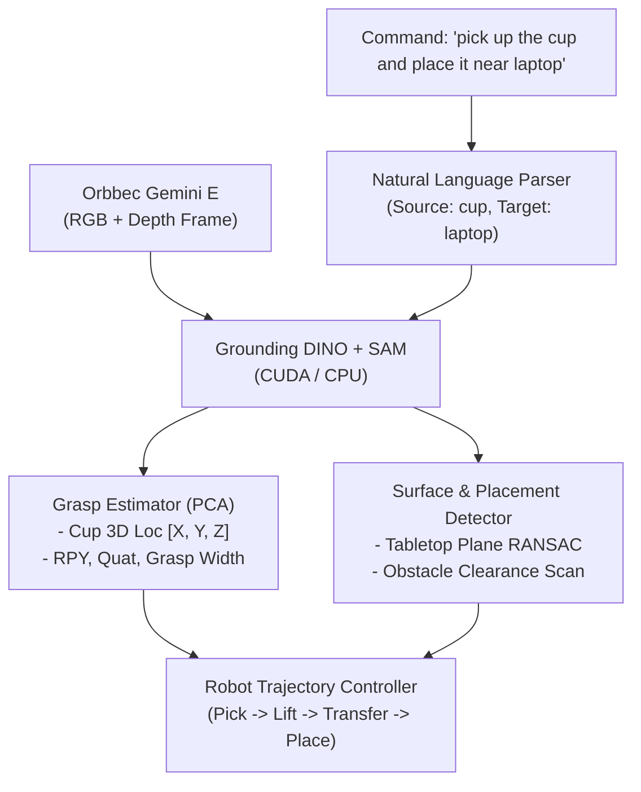
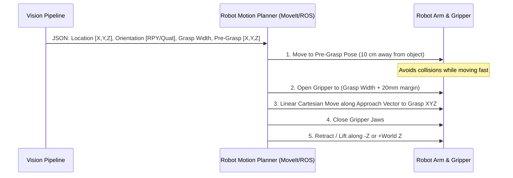

# 🤖 3D Perception, Robotic Grasping & Pick-and-Place Pipeline
### *A Practical, Plain-English Guide to Vision-Guided Manipulation*

---

## 📌 1. High-Level Overview: What Does This System Do?

Imagine your robot has an eye (the **Orbbec Gemini E** camera) and a hand (a **parallel-jaw or multi-finger gripper**).

If you tell your robot:
> *"Pick up the cup and place it near laptop"*

The robot needs to know:
1. **Which object to pick?** Detects the cup, isolates its exact pixels via SAM, and computes its **3D grasp location $(X, Y, Z)$ and 6-DoF orientation (Roll, Pitch, Yaw, Quaternions)**.
2. **Where is the reference object (laptop)?** Detects and locates the laptop in 3D physical coordinates.
3. **Where is the supporting surface (table)?** Fits a 3D plane to the tabletop surface using RANSAC.
4. **Where is there free, obstacle-free space to put the cup?** Scans the table around the laptop to guarantee a safe landing zone with at least 12 cm clearance radius.
5. **How should all parameters be tuned?** Managed cleanly via [config.yaml](file:///C:/Omshinde/Projects/Perception-skandha/Segmentation_based_vision/config.yaml).



---

## 🔍 2. Step-by-Step Architecture & Logic

Let's break down each stage in simple language with concrete examples.

---

### Step 2.1: Image & Depth Capture (`orbbec_camera.py`)

* **What it does:**
  * Captures a synchronized pair of frames every tick:
    1. **Color Frame (RGB):** $640 \times 480$ pixels showing colors and shapes.
    2. **Depth Frame (D):** $640 \times 480$ array where every pixel value tells you how far away that point is from the camera lens (in millimeters/meters).
* **Why it matters:**
  Standard cameras only give 2D ($u, v$) pixels. Without depth ($Z$), a miniature toy cup at 20 cm looks identical to a giant bucket at 2 meters! Depth removes all ambiguity.

---

### Step 2.2: Text-Guided Detection with Grounding DINO (`grounded_sam.py`)

* **What it does:**
  * Grounding DINO is an **open-vocabulary detector**. Unlike older models (like YOLO trained only on 80 fixed COCO classes), you can give Grounding DINO **any natural language text**:
    * `"red can"`, `"screwdriver"`, `"drill"`, `"coffee mug"`, `"white plastic box"`.
  * It scans the image and draws a 2D bounding box $[x_1, y_1, x_2, y_2]$ around anything matching that description with a confidence score.

---

### Step 2.3: Precision Segmentation with SAM (Segment Anything) (`grounded_sam.py`)

* **Why a bounding box is not enough for robotic grasping:**
  A rectangle around a mug also includes the wooden table behind the mug, shadows, and the empty air around the handle. If a robot tried to grasp the average point inside the bounding box, it might try to grab the table surface instead!
* **What SAM does:**
  * We pass the bounding box from Grounding DINO into SAM as a prompt.
  * SAM outputs a **binary mask** ($1$ for cup pixels, $0$ for everything else).
  * Only pixels physically touching the cup are kept.

---

### Step 2.4: 2D-to-3D Deprojection (Pinhole Camera Geometry)

* **The Math in Simple Terms:**
  Every pixel $(u, v)$ on the sensor screen corresponds to a light ray entering the camera lens.
  Using the camera's intrinsic calibration matrix ($f_x, f_y, c_x, c_y$):
  * $f_x, f_y$: Focal lengths (how strongly the lens bends light).
  * $c_x, c_y$: Optical center (where the center of the lens hits the sensor).
  * $Z$: Distance measured by the depth sensor at that pixel.

$$\begin{aligned}
X &= \frac{(u - c_x) \times Z}{f_x} \\
Y &= \frac{(v - c_y) \times Z}{f_y} \\
Z &= Z
\end{aligned}$$

* **Example:**
  If a cup's center pixel is at $(u=220, v=280)$ and the depth sensor reads $Z = 0.650\text{ m}$ (65 cm away):
  The formula gives real physical coordinates:
  $$X = -0.117\text{ m}\quad (\text{11.7 cm to the left of camera center})$$
  $$Y = +0.046\text{ m}\quad (\text{4.6 cm below the camera lens})$$
  $$Z = +0.650\text{ m}\quad (\text{65.0 cm straight ahead})$$

---

### Step 2.5: 3D PCA for 6-DoF Grasp Orientation (`grasp_estimator.py`)

Now the robot knows the 3D position $(X, Y, Z)$. But how should it turn its gripper? Should it come from the top? From the front? Should the fingers open horizontally or vertically?

We run **Principal Component Analysis (PCA)** on the 3D point cloud of the isolated object:

```
          Major Axis (v1) -> Object length (e.g. height of a bottle)
          ▲
          │      ┌────────┐
          │      │        │
          │      │ Bottle │  ◄── Minor Axis (v2) -> Width of bottle
          │      │        │      (Gripper jaws close along this line!)
          │      └────────┘
          └────────────────────────►
```

1. **Approach Vector ($\vec{z}_{\text{gripper}}$ / Blue Arrow):**
   The direction the gripper moves toward the object (along the camera ray or object surface normal).
2. **Closing Axis ($\vec{x}_{\text{gripper}}$ / Red Arrow):**
   The direction along which the gripper fingers must close. PCA finds the narrower width axis so the gripper doesn't try to clamp across the longest dimension where its fingers can't reach.
3. **Binormal Axis ($\vec{y}_{\text{gripper}}$ / Green Arrow):**
   Perpendicular to both closing and approach vectors ($\vec{y} = \vec{z} \times \vec{x}$).
4. **Grasp Width ($W$):**
   The physical span in millimeters the gripper must open to clear the object safely without knocking it over.

---

## 📐 3. What is Roll, Pitch, Yaw (RPY) w.r.t. Camera?

When working with robots, every rotation is measured relative to a **Reference Coordinate Frame**.

In this pipeline, all coordinates and orientations are expressed **w.r.t. Camera Optical Frame**:
* **$+X$**: Points **Right** (towards the right side of the camera).
* **$+Y$**: Points **Down** (towards the ground/table).
* **$+Z$**: Points **Forward** (straight out of the camera lens into the room).

```
          Camera Optical Frame
                 ▲ -Y (Up)
                 │
                 │   +Z (Forward / Depth into scene)
                 │  /
                 │ /
  -X (Left) ─────┼─────► +X (Right)
                /│
               / │
              /  ▼ +Y (Down)
```

### What do Roll, Pitch, and Yaw mean?

| Angle | Rotation Axis | Intuitive Meaning for Gripper |
| :--- | :--- | :--- |
| **Roll ($\phi$)** | Around $+X$ (Camera Right) | Tilting the gripper up or down relative to the horizontal plane. |
| **Pitch ($\theta$)**| Around $+Y$ (Camera Down) | Swiveling the gripper left or right. |
| **Yaw ($\psi$)** | Around $+Z$ (Camera Forward) | Twisting the gripper wrist clockwise or counter-clockwise like turning a screwdriver. |

### Concrete Example

Consider the test detection of a cup:
* **Roll**: $-10.4^\circ$ $\rightarrow$ Gripper is slightly tilted up by $10.4^\circ$ to approach perpendicular to the table.
* **Pitch**: $+3.4^\circ$ $\rightarrow$ Minor horizontal angle alignment.
* **Yaw**: $+86.4^\circ$ $\rightarrow$ Gripper fingers are turned almost $90^\circ$ sideways to straddle the cup diameter.
* **Quaternions $[q_w, q_x, q_y, q_z]$**: $[0.7238, -0.0863, -0.0405, 0.6834]$.
  * *Why Quaternions?* Robotics motion planners (ROS MoveIt, KDL, Pinocchio) prefer quaternions over Euler angles because quaternions **never suffer from Gimbal Lock** (singularity where two axes align and lose a degree of freedom).

---

## 🤖 4. How Does This Help Your Robot & How to Adapt It?

### 4.1 Robot Motion Sequence (End-to-End Workflow)

When this vision pipeline sends a JSON packet to your robot controller, here is the standard industrial state machine:



---

### 4.2 Adapting to Different Robot Setups

Depending on where you mount your Orbbec camera, you only need one mathematical transform:

#### Scenario A: Eye-in-Hand (Camera mounted on the robot wrist)
* The camera moves with the gripper.
* The location from our pipeline ($^{C}\mathbf{P}$) is converted to base frame ($^{B}\mathbf{P}$) using the robot's current forward kinematics ($^{B}\mathbf{T}_E$) and the fixed hand-eye calibration matrix ($^{E}\mathbf{T}_C$):
  $$^{B}\mathbf{P} = {^{B}\mathbf{T}_E} \times {^{E}\mathbf{T}_C} \times {^{C}\mathbf{P}}$$

#### Scenario B: Eye-to-Hand (Camera mounted on a fixed tripod or ceiling overlooking the table)
* The camera is static.
* Perform a one-time hand-eye calibration (e.g. using a ChArUco board held by the gripper) to get the fixed matrix $^{B}\mathbf{T}_C$.
  $$^{B}\mathbf{P} = {^{B}\mathbf{T}_C} \times {^{C}\mathbf{P}}$$

---

### 4.3 Adapting to Different Grippers

* **2-Finger Parallel Jaw Gripper (e.g. Robotiq 2F-85, OnRobot 2FG7, Franka Hand):**
  * Use `grasp.gripper.required_width_mm`.
  * Open gripper to `required_width_mm + 15 mm`, approach along `approach_vector`, then command close.
* **Suction Cup / Vacuum Gripper:**
  * For suction, gripper orientation is simpler: align the suction cup normal directly with the `approach_vector` $[z_x, z_y, z_z]$ targeting `location_xyz`.
* **Multi-Finger Hand (e.g. Allegro Hand, Shadow Hand):**
  * Use the PCA bounding box extent `bounding_box_extent_xyz_m` to select grasp preshapes (cylindrical power grasp for bottles, pinch grasp for small boxes).

---

## 📊 5. Complete JSON Payload Reference

Every time the pipeline detects an object, it outputs a clean, ready-to-use JSON payload:

```json
{
  "status": "SUCCESS",
  "timestamp": 1728986241.12,
  "camera": {
    "name": "Orbbec Gemini E",
    "is_hardware": true
  },
  "prompt": "cup",
  "count": 1,
  "objects": [
    {
      "label": "cup",
      "confidence": 0.84,
      "num_3d_points": 1420,
      "3d_location_wrt_camera": {
        "units": "meters",
        "x": -0.1170,
        "y": 0.0460,
        "z": 0.6506,
        "xyz_list": [-0.1170, 0.0460, 0.6506],
        "xyz_mm": [-117.0, 46.0, 650.6],
        "bounding_box_extent_xyz_m": [0.088, 0.105, 0.085]
      },
      "grasp": {
        "location_xyz": {
          "units": "meters",
          "x": -0.1170,
          "y": 0.0460,
          "z": 0.6506,
          "xyz_list": [-0.1170, 0.0460, 0.6506],
          "xyz_mm": [-117.0, 46.0, 650.6]
        },
        "orientation": {
          "convention": "XYZ_extrinsic_zyx_intrinsic",
          "roll_pitch_yaw_deg": {
            "roll": -10.4,
            "pitch": 3.4,
            "yaw": 86.41
          },
          "roll_pitch_yaw_rad": {
            "roll": -0.1815,
            "pitch": 0.0593,
            "yaw": 1.5081
          },
          "quaternion_wxyz": {
            "qw": 0.72378,
            "qx": -0.08625,
            "qy": -0.04051,
            "qz": 0.68342,
            "wxyz_list": [0.72378, -0.08625, -0.04051, 0.68342]
          },
          "rotation_matrix_3x3": [
            [0.0626, -0.9823, -0.1765],
            [0.9963, 0.0510, 0.0695],
            [-0.0593, -0.1802, 0.9818]
          ],
          "planar_yaw_angle_deg": 90.0
        },
        "gripper": {
          "required_width_m": 0.0887,
          "required_width_mm": 88.7,
          "approach_vector": [-0.1765, 0.0695, 0.9818],
          "pre_grasp_standoff_xyz_m": [-0.0993, 0.0391, 0.5524]
        }
      }
    }
  ]
}
```

---

## 🚀 6. Quick Cheat-Sheet for Running

```powershell
# 1. Live stream from Orbbec Gemini E
.venv\Scripts\python.exe main.py --prompt "cup"

# 2. Single frame inspection with custom confidence thresholds
.venv\Scripts\python.exe main.py --prompt "bottle" --single-frame --box-threshold 0.20 --text-threshold 0.15

# 3. Offline simulation mode (when camera is disconnected)
.venv\Scripts\python.exe main.py --prompt "box" --camera mock

# 4. Run automated test suite
.venv\Scripts\python.exe test_pipeline.py
```

### Interactive Keyboard Controls in Live Window
* **`p <new prompt>`**: Switch object prompt on the fly (e.g. `p bottle` or `p red mug`).
* **`s`**: Capture and save annotated `.png` and `.json` in `output/`.
* **`q` or `ESC`**: Clean shutdown.
